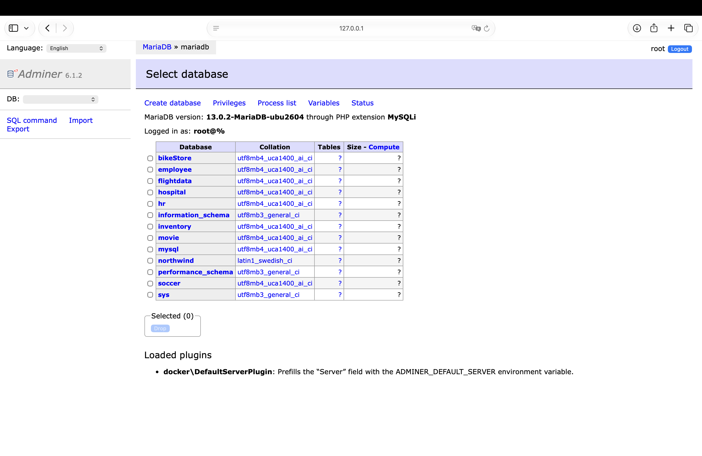
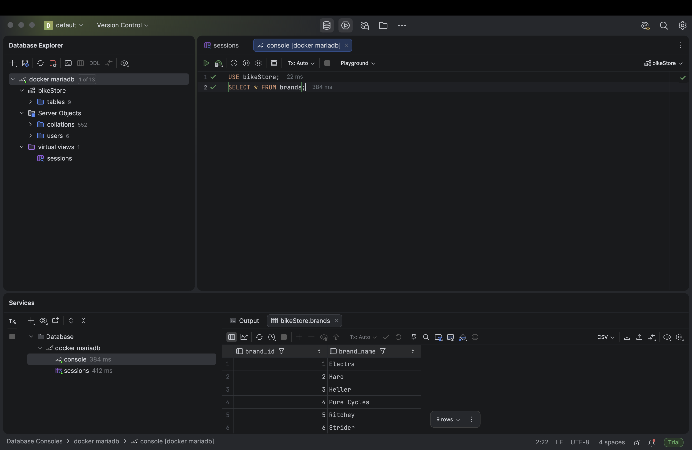
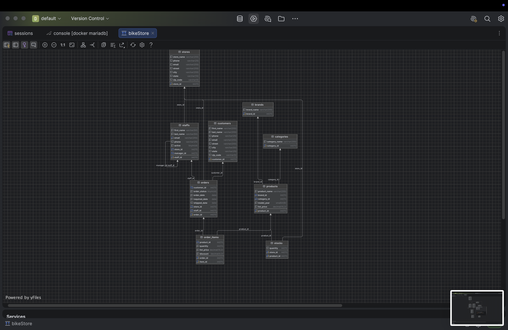
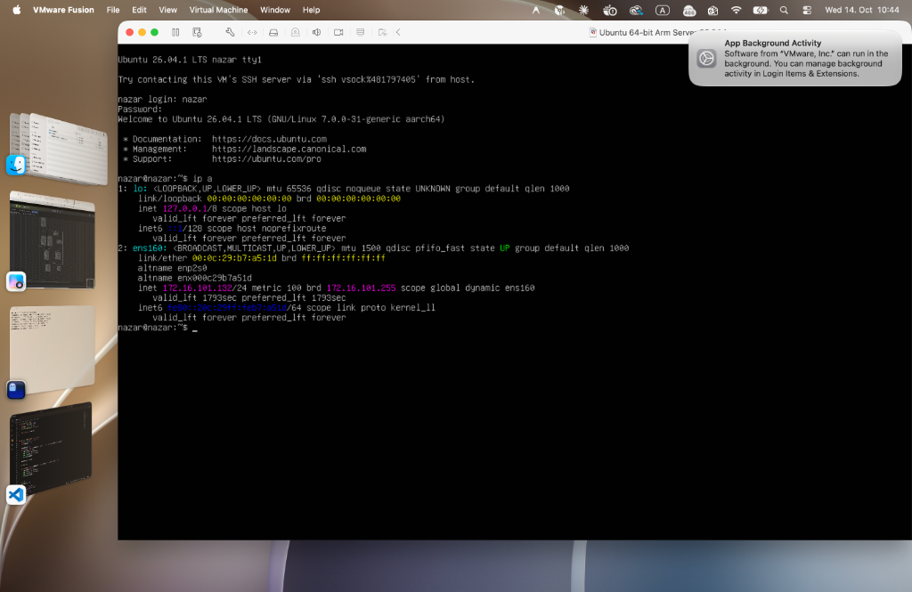
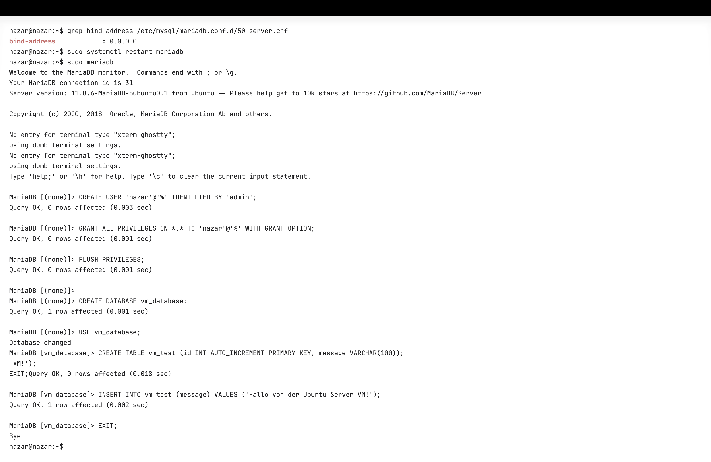
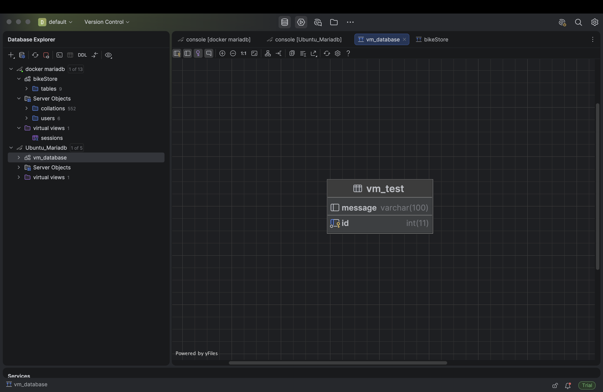

# Dokumentation: GEK53 Datenbanksystem Installation

- **Schule / Abteilung:** Technologisches Gewerbemuseum (TGM) – Informationstechnologie
- **Fach:** Informationssysteme (INSY)
- **Thema:** GEK53 – Datenbanksystem Installation (Grund- und erweiterte Anforderungen)
- **Kompetenz:** GK Datenbanksystem installieren
- **Autor:** Nazar Tymoshenko
- **Datum:** 14. Oktober 2026

---

## Inhaltsverzeichnis
1. [Einführung & Aufgabenstellung](#1-einführung--aufgabenstellung)
2. [Fragestellungen & Theoretische Grundlagen](#2-fragestellungen--theoretische-grundlagen)
   - 2.1 [Grundlegende Fragestellungen](#21-grundlegende-fragestellungen)
   - 2.2 [Erklärung des verwendeten `compose.yml`](#22-erklärung-des-verwendeten-composeyml)
   - 2.3 [Erweiterte Fragestellungen](#23-erweiterte-fragestellungen)
3. [Praktische Durchführung: Grundanforderungen (Docker & DataGrip)](#3-praktische-durchführung-grundanforderungen)
   - 3.1 [Bereitstellung & Start der Container](#31-bereitstellung--start-der-container)
   - 3.2 [Verifikation im Web-Client Adminer](#32-verifikation-im-web-client-adminer)
   - 3.3 [Konfiguration von JetBrains DataGrip](#33-konfiguration-von-jetbrains-datagrip)
   - 3.4 [SQL-Abfragen & Ergebnisanalyse](#34-sql-abfragen--ergebnisanalyse)
   - 3.5 [ER-Diagramm & Datenmodell-Visualisierung](#35-er-diagramm--datenmodell-visualisierung)
4. [Praktische Durchführung: Erweiterte Anforderungen (Ubuntu Server VM & Native MariaDB)](#4-praktische-durchführung-erweiterte-anforderungen)
   - 4.1 [Aufsetzen der VM in VMware Fusion & Netzwerkanalyse](#41-aufsetzen-der-vm-in-vmware-fusion--netzwerkanalyse)
   - 4.2 [SSH-Verbindung & Fernwartung](#42-ssh-verbindung--fernwartung)
   - 4.3 [Native Installation & Dienstüberprüfung von MariaDB](#43-native-installation--dienstüberprüfung-von-mariadb)
   - 4.4 [Konfiguration für Remote-Zugriff (`bind-address = 0.0.0.0`)](#44-konfiguration-für-remote-zugriff-bind-address--0000)
   - 4.5 [Benutzer- und Datenbankeinrichtung für Remote-Clients](#45-benutzer--und-datenbankeinrichtung-für-remote-clients)
   - 4.6 [Erfolgreiche Anbindung beider Datenquellen in DataGrip](#46-erfolgreiche-anbindung-beider-datenquellen-in-datagrip)
5. [Reflexion & Erkenntnisse](#5-reflexion--erkenntnisse)
6. [Quellenverzeichnis](#6-quellenverzeichnis)

---

## 1. Einführung & Aufgabenstellung

Im Rahmen der Übung **GEK53 Datenbanksystem Installation** wurden zwei praxisnahe Methoden zur Bereitstellung eines relationalen Datenbanksystems (**MariaDB**) eigenständig aufgesetzt, konfiguriert und verifiziert:

1. **Grundanforderungen (Container-basiert):**
   - Bereitstellung eines MariaDB-Containers und einer Web-Verwaltungsoberfläche (**Adminer**) mittels **Docker Compose**.
   - Anbindung der containerisierten Datenbank an die Entwicklungs-IDE **JetBrains DataGrip**.
   - Durchführung von Abfragen und Visualisierung eines relationalen Schemas (ER-Diagramm).
2. **Erweiterte Anforderungen (Virtual Machine / Bare-Metal-Ansatz):**
   - Bereitstellung einer Linux Server VM (**Ubuntu Server 26.04.1 LTS**) ohne grafische Oberfläche (Headless).
   - Remote-Administration über eine verschlüsselte Netzwerkverbindung (**SSH**).
   - Native Installation, Absicherung und Konfiguration von MariaDB für den Remote-Netzwerkzugriff.
   - Parallele Verbindung und Visualisierung in DataGrip über das Netzwerk zur virtuellen Maschine.

---

## 2. Fragestellungen & Theoretische Grundlagen

### 2.1 Grundlegende Fragestellungen

#### Was ist ein Container?
Ein Container ist eine standardisierte, isolierte und leichtgewichtige Software-Ausführungsumgebung. Er bündelt den Anwendungscode zusammen mit allen benötigten Abhängigkeiten, System-Tools, Bibliotheken und Konfigurationsdateien. 

Im Gegensatz zu klassischen Virtualisierungsansätzen teilen sich Container den Kernel des Host-Betriebssystems. Die Isolation wird durch Kernelfunktionen des Linux-Betriebssystems realisiert:
- **Namespaces:** Isolieren Sichtbarkeiten für Prozesse (PID), Netzwerkschnittstellen (NET), Benutzer-IDs (USER), Dateisystem-Mounts (MNT) und Interprozesskommunikation (IPC).
- **Control Groups (cgroups):** Überwachen und limitieren den Ressourcenverbrauch (z. B. maximale CPU-Last, RAM-Verbrauch und I/O-Bandbreite).

#### Wo ist der Unterschied zu einer VM (Virtuelle Maschine)?
| Kriterium | Container (z. B. Docker) | Virtuelle Maschine (z. B. VMware Fusion, VirtualBox) |
| :--- | :--- | :--- |
| **Architektur** | Teilt sich den Kernel des Host-Betriebssystems | Benötigt einen Hypervisor (Typ 1 oder Typ 2) |
| **Betriebssystem** | Kein eigenes Gast-OS erforderlich | Jede VM bootet ein vollständiges Gast-Betriebssystem |
| **Startzeit** | Millisekunden bis wenige Sekunden | Mehrere Sekunden bis Minuten (voller OS-Boot) |
| **Ressourcenbedarf** | Sehr gering (nur für Anwendungsdaten & Libraries) | Hoch (mehrere GB RAM, virtueller Festplattenspeicher) |
| **Isolation** | Prozess-Isolation auf Kernel-Ebene | Strikte Hardware-Virtualisierung auf Maschinenebene |

#### Was sind die Vor- und Nachteile von Containern?
- **Vorteile:**
  - **Ressourceneffizienz:** Es entfällt der Overhead mehrerer paralleler Gast-Betriebssysteme.
  - **Geschwindigkeit:** Container starten und stoppen nahezu verzögerungsfrei.
  - **Portabilität:** „Build once, run anywhere“ – das Container-Image läuft auf jedem System mit Docker exakt identisch.
  - **Versionierung & Reproduzierbarkeit:** Container-Images sind unveränderlich (*immutable*) und basieren auf wiederverwendbaren Layern.
- **Nachteile:**
  - **Geringere Isolationstiefe:** Da alle Container denselben Host-Kernel nutzen, betrifft ein potenzieller Kernel-Exploit das Gesamtsystem.
  - **Kernel-Abhängigkeit:** Native Linux-Container benötigen einen Linux-Kernel (auf macOS/Windows wird intern eine leichtgewichtige Linux-VM via HyperKit/Virtualization Framework/WSL2 bereitgestellt).
  - **Zustandslosigkeit (*Statelessness*):** Daten im beschreibbaren Container-Layer gehen beim Löschen des Containers verloren, weshalb persistente Volumes explizit konfiguriert werden müssen.

#### Wie installiert man sich einen Container?
Container werden auf Basis von **Images** instantiiert, die aus Repositories (z. B. Docker Hub) heruntergeladen werden:
1. **Per Terminal-Befehl (CLI):**
   ```bash
   docker run -d --name mariadb -p 127.0.0.1:3306:3306 -e MARIADB_ROOT_PASSWORD=admin mariadb
   ```
2. **Deklarativ über Docker Compose:**
   Durch Definition der Services in einer Datei `compose.yml` und Ausführung von:
   ```bash
   docker compose up -d
   ```

#### Wie bekommt man Daten/Verbindung in/aus dem Container?
- **Netzwerk-Verbindungen:**
  - **Port-Mapping (`ports:`):** Verknüpft einen Port des Host-Rechners mit einem Port des Containers (z. B. `127.0.0.1:3306:3306`).
  - **Docker-Netzwerke:** Container im selben Netzwerk kommunizieren untereinander direkt über ihre Servicenamen als DNS-Hostnamen (z. B. erreicht `adminer` den Datenbankservice über `mariadb`).
- **Dateien & Datenpersistenz:**
  - **Volumes (Named Volumes):** Von Docker isoliert auf dem Host verwaltete Speicherbereiche (z. B. `mariadb-data:/var/lib/mysql`), die Container-Lebenszyklen überdauern.
  - **Bind Mounts:** Direkte Einbindung eines lokalen Host-Verzeichnisses in den Container (z. B. `./Sample_databases:/docker-entrypoint-initdb.d`), ideal zum Einspielen von SQL-Initialisierungsskripten.
  - **CLI-Kopieren:** Nachträglicher Dateitransfer mittels `docker cp <host_pfad> <container>:<ziel_pfad>`.

#### Was ist ein Docker Compose File?
Ein Docker Compose File (standardmäßig `compose.yml`) ist eine Konfigurationsdatei im YAML-Format. Sie beschreibt Multi-Container-Anwendungen deklarativ. Sämtliche Services, Images, Abhängigkeiten, Umgebungsvariablen, Portfreigaben, Healthchecks und Volumes werden gebündelt erfasst und können synchron mit einem einzigen Befehl gestartet, überwacht und gestoppt werden.

---

### 2.2 Erklärung des verwendeten `compose.yml`

In dieser Übung wurde folgende `compose.yml` eingesetzt:

```yaml
# Use root/admin as user/password credentials

name: mariadb

services:
  mariadb:
    image: mariadb
    container_name: mariadb
    restart: always
    ports:
      - 127.0.0.1:3306:3306
    environment:
      MARIADB_ROOT_PASSWORD: admin
    healthcheck:
      test: ["CMD", "healthcheck.sh", "--connect", "--innodb_initialized"]
      interval: 10s
      timeout: 5s
      retries: 5
      start_period: 30s
    volumes:
      - mariadb-data:/var/lib/mysql
      - ./Sample_databases:/docker-entrypoint-initdb.d

  # optionale web DB client
  # https://www.adminer.org/
  # Server: mariadb
  adminer:
    image: adminer
    container_name: adminer
    ports:
      - 127.0.0.1:8081:8080
    environment:
      - ADMINER_DEFAULT_SERVER=mariadb
    healthcheck:
      test: ["CMD", "wget", "-q", "--spider", "http://127.0.0.1:8080/"]
      interval: 30s
      timeout: 5s
      retries: 3
      start_period: 10s
    depends_on:
      mariadb:
        condition: service_healthy

volumes:
  mariadb-data:
```

#### Detaillierte Analyse der Konfigurationsparameter:
1. **`name: mariadb`**: Gibt dem Docker Compose Projekt einen eindeutigen Projektnamen.
2. **Service `mariadb`**:
   - `image: mariadb`: Lädt das offizielle MariaDB-Image von Docker Hub.
   - `container_name: mariadb`: Fester Containernamen zur direkten Referenzierung.
   - `restart: always`: Automatischer Neustart bei Absturz oder Systemreboot.
   - `ports: - 127.0.0.1:3306:3306`: Leitet Port 3306 des Containers an den lokalen Port 3306 des Hosts weiter.
   - `environment: MARIADB_ROOT_PASSWORD: admin`: Setzt das Administrator-Passwort für `root`.
   - `healthcheck`: Überprüft mit `healthcheck.sh`, ob MariaDB verbindungsbereit und InnoDB initialisiert ist.
   - `volumes`:
     - `mariadb-data:/var/lib/mysql`: Persistiert alle erstellten Tabellen im Docker-Volume.
     - `./Sample_databases:/docker-entrypoint-initdb.d`: Führt beim ersten Start automatisch alle `.sql`-Dateien im Ordner aus.
3. **Service `adminer`**:
   - `image: adminer`: Webbasierte Verwaltungsoberfläche.
   - `ports: - 127.0.0.1:8081:8080`: Macht Adminer über den Browser unter `http://localhost:8081` erreichbar.
   - `environment: - ADMINER_DEFAULT_SERVER=mariadb`: Trägt automatisch den Hostnamen `mariadb` als Zielserver ein.
   - `depends_on: mariadb: condition: service_healthy`: Stellt sicher, dass Adminer erst startet, wenn MariaDB betriebsbereit ist.

---

### 2.3 Erweiterte Fragestellungen

#### Unterschied zwischen Ubuntu und Ubuntu Server
- **Ubuntu Desktop:** Richtet sich an Endanwender. Es enthält ein vollwertiges Desktop Environment (GNOME), Fenstermanager, Grafiktreiber und Anwendungssoftware (z. B. Firefox, LibreOffice). Dadurch benötigt es deutlich mehr CPU, RAM und Festplattenspeicher.
- **Ubuntu Server:** Optimiert für Rechenzentren und Serverbetrieb. Es besitzt **keinerlei grafische Oberfläche (Headless / reine CLI)** und verzichtet auf Desktop-Pakete. Stattdessen stehen Server-Basisdienste, Stabilität und maximale Ressourceneffizienz im Vordergrund.

#### Was ist Ubuntu LTS?
**LTS** steht für **Long Term Support**. Canonical veröffentlicht alle zwei Jahre (im April von geraden Jahren, z. B. 22.04 LTS, 24.04 LTS, 26.04 LTS) eine LTS-Version:
- Standardmäßig **5 Jahre** garantierte Sicherheitsaktualisierungen und Systempflege.
- Konzipiert für maximale Stabilität und Zuverlässigkeit in Produktivumgebungen ohne unvorhergesehene Breaking Changes.

#### Was ist SSH?
**SSH (Secure Shell)** ist ein kryptographisches Netzwerkprotokoll (Standardport: TCP 22), das eine sichere, verschlüsselte Verbindung zwischen zwei Rechnern über unsichere Netzwerke ermöglicht. Es gewährleistet Authentifizierung (Passwort oder Public-Key-Verfahren), Datenintegrität und Verschlüsselung aller übertragenen Daten. Es wird zur textbasierten Fernwartung, Dateiübertragung (SFTP/SCP) sowie für Port-Tunneling eingesetzt.

---

## 3. Praktische Durchführung: Grundanforderungen

### 3.1 Bereitstellung & Start der Container

Im Projektverzeichnis `mariadb/` wurden die `compose.yml` und die Beispieldatenbanken im Ordner `Sample_databases/` bereitgestellt. Anschließend wurden die Container im Hintergrund gestartet:

```bash
cd mariadb
docker compose up -d
```

Überprüfung der Container:
```bash
docker compose ps
```
Beide Services erreichten nach erfolgreichem Healthcheck den Status `healthy`.

---

### 3.2 Verifikation im Web-Client Adminer

Unter `http://localhost:8081` wurde die Web-IDE Adminer geöffnet und die Anmeldung durchgeführt:
- **System:** `MySQL` | **Server:** `mariadb` | **Benutzer:** `root` | **Passwort:** `admin`

Alle Datenbanken aus `Sample_databases` wurden erfolgreich geladen (`bikeStore`, `employee`, `flightdata`, `hospital`, `hr`, `inventory`, `movie`, `northwind`, `soccer`):


*Abbildung 1: Erfolgreicher Login in Adminer 6.1.2 mit Auflistung aller importierten Datenbanken.*

---

### 3.3 Konfiguration von JetBrains DataGrip

In DataGrip wurde die Verbindung zu Docker MariaDB hergestellt:
- **Host:** `localhost` | **Port:** `3306` | **User:** `root` | **Password:** `admin`
- **Test Connection** bestätigte die Verbindung erfolgreich.

---

### 3.4 SQL-Abfragen & Ergebnisanalyse

In der DataGrip Query Console (`console [docker mariadb]`) wurde eine Abfrage auf das Schema `bikeStore` abgesetzt:

```sql
USE bikeStore;
SELECT * FROM brands;
```

DataGrip lieferte in 384 ms alle 9 Datensätze der Fahrradmarken:


*Abbildung 2: Ausführung von SQL-Befehlen und Anzeige der tabellarischen Ergebnisse in DataGrip.*

---

### 3.5 ER-Diagramm & Datenmodell-Visualisierung

Über das Kontextmenü von `bikeStore` $\rightarrow$ **Diagrams** $\rightarrow$ **Show Visualization...** (`Cmd + Alt + U`) wurde das relationale Diagramm mit allen Tabellen und Fremdschlüssel-Relationen visualisiert:


*Abbildung 3: Generiertes Entity-Relationship-Diagramm des Schemas bikeStore in JetBrains DataGrip.*

---

## 4. Praktische Durchführung: Erweiterte Anforderungen

### 4.1 Aufsetzen der VM in VMware Fusion & Netzwerkanalyse

In **VMware Fusion** wurde eine VM mit **Ubuntu 26.04.1 LTS Arm Server** aufgesetzt. Nach dem Starten in die reine CLI wurde die IP-Adresse über `ip a` ermittelt:


*Abbildung 4: Konsolenausgabe in VMware Fusion: Ubuntu 26.04.1 LTS Server mit IP-Konfiguration (172.16.101.132).*

- **Netzwerk-Schnittstelle:** `ens160`
- **IP-Adresse der VM:** **`172.16.101.132`**

---

### 4.2 SSH-Verbindung & Fernwartung

Vom macOS-Terminal wurde die SSH-Verbindung zur Server-VM hergestellt:
```bash
ssh nazar@172.16.101.132
```
Die Authentifizierung erfolgte via Passwort für den Benutzer `nazar`.

---

### 4.3 Native Installation & Dienstüberprüfung von MariaDB

Auf der Ubuntu Server VM wurde MariaDB Server nativ über den Paketmanager installiert:
```bash
sudo apt update
sudo apt install -y mariadb-server
sudo systemctl status mariadb
```
Der Dienst `mariadbd` (Version 11.8.6) startete erfolgreich als aktiver systemd-Dienst.

---

### 4.4 Konfiguration für Remote-Zugriff (`bind-address = 0.0.0.0`)

Standardmäßig lauscht MariaDB nur auf `127.0.0.1`. Für den Zugriff von externen Clients wurde die Bind-Adresse in `/etc/mysql/mariadb.conf.d/50-server.cnf` auf `0.0.0.0` geändert und mit `grep` verifiziert:

```bash
sudo sed -i 's/127\.0\.0\.1/0.0.0.0/g' /etc/mysql/mariadb.conf.d/50-server.cnf
grep bind-address /etc/mysql/mariadb.conf.d/50-server.cnf
# Ausgabe: bind-address = 0.0.0.0
```

Anschließend wurde der Dienst neu gestartet:
```bash
sudo systemctl restart mariadb
```

---

### 4.5 Benutzer- und Datenbankeinrichtung für Remote-Clients

In der MariaDB-Konsole (`sudo mariadb`) wurde der Remote-Benutzer `nazar` angelegt und die Testdatenbank `vm_database` mit Tabelle `vm_test` erzeugt:

```sql
CREATE USER 'nazar'@'%' IDENTIFIED BY 'admin';
GRANT ALL PRIVILEGES ON *.* TO 'nazar'@'%' WITH GRANT OPTION;
FLUSH PRIVILEGES;

CREATE DATABASE vm_database;
USE vm_database;
CREATE TABLE vm_test (id INT AUTO_INCREMENT PRIMARY KEY, message VARCHAR(100));
INSERT INTO vm_test (message) VALUES ('Hallo von der Ubuntu Server VM!');
EXIT;
```


*Abbildung 5: SSH-Terminal mit erfolgreicher bind-address-Prüfung, Dienstneustart, User- und Tabellenerstellung.*

---

### 4.6 Erfolgreiche Anbindung beider Datenquellen in DataGrip

In JetBrains DataGrip wurde die neue Datenquelle `Ubuntu_Mariadb` angelegt:
- **Host:** `172.16.101.132` | **Port:** `3306` | **User:** `nazar` | **Password:** `admin`

Beide Datenbanksysteme (**Docker MariaDB** und **Ubuntu_Mariadb**) sind nun parallel in DataGrip angebunden. Das Datenmodell der erstellten Tabelle `vm_test` in `vm_database` wurde im Diagramm-Viewer visualisiert:


*Abbildung 6: JetBrains DataGrip mit beiden aktiven Verbindungen (docker mariadb & Ubuntu_Mariadb) und dem ER-Diagramm von vm_test.*

---

## 5. Reflexion & Erkenntnisse

Die erfolgreiche Bearbeitung beider Teile liefert wichtige Erkenntnisse für moderne Software- und Datenbankarchitekturen:

1. **Docker Compose:** Bietet maximale Reproduzierbarkeit und minimiert Konfigurationsaufwand für Entwickler.
2. **Native Linux Server Installation:** Vermittelt essenzielle Grundlagen der Systemadministration: Netzwerkadressierung, Dienststeuerung über `systemctl`, Sicherheitsarchitektur relationaler DBMS (`bind-address`, Benutzer-Host-Rechte wie `nazar@%`).
3. **JetBrains DataGrip:** Zeigt seine Stärke als universelle IDE, mit der lokale Container und entfernte Server-VMs nahtlos parallel verwaltet, abgefragt und visualisiert werden können.

---

## 6. Quellenverzeichnis

1. Canonical Ltd. (2024). *Ubuntu Server Documentation & Release Lifecycle*. Abgerufen von [https://ubuntu.com/download/server](https://ubuntu.com/download/server)
2. DigitalOcean (2020). *Installieren von MariaDB unter Ubuntu 20.04*. Abgerufen von [https://www.digitalocean.com/community/tutorials/how-to-install-mariadb-on-ubuntu-20-04-de](https://www.digitalocean.com/community/tutorials/how-to-install-mariadb-on-ubuntu-20-04-de)
3. Docker Inc. (2024). *Docker Documentation – Overview and Compose Specification*. Abgerufen von [https://docs.docker.com/](https://docs.docker.com/)
4. JetBrains s.r.o. (2024). *DataGrip Documentation & Database Connectivity*. Abgerufen von [https://www.jetbrains.com/datagrip/](https://www.jetbrains.com/datagrip/)
5. Loshin, P. (2022). *Definition Secure Shell (SSH)*. ComputerWeekly. Abgerufen von [https://www.computerweekly.com/de/definition/Secure-Shell-SSH](https://www.computerweekly.com/de/definition/Secure-Shell-SSH)
6. MakeUseOf (2021). *Ubuntu Desktop vs. Ubuntu Server: What’s the Difference?*. Abgerufen von [https://www.makeuseof.com/tag/difference-ubuntu-desktop-ubuntu-server/](https://www.makeuseof.com/tag/difference-ubuntu-desktop-ubuntu-server/)
7. MariaDB Foundation (2024). *Configuring MariaDB for Remote Client Access*. Abgerufen von [https://mariadb.com/kb/en/configuring-mariadb-for-remote-client-access/](https://mariadb.com/kb/en/configuring-mariadb-for-remote-client-access/)
8. phoenixNAP (2020). *How to Allow Remote Connections to MySQL / MariaDB*. Abgerufen von [https://phoenixnap.com/kb/mysql-remote-connection](https://phoenixnap.com/kb/mysql-remote-connection)
